 

---

## 👋 Hey, I'm Ahmadshoh

I'm a **Senior Full-Stack Engineer** in Stuttgart. I build **multi-tenant ERP platforms** on Frappe/ERPNext
and **AI agents that work with real business data** — invoices, stock, cash, customers — not toy demos.

I founded **[Tijorat+](https://tijorat.plus)**, a cloud ERP & POS for businesses in Tajikistan, and I'm building
**[TijoratAI](https://tijorat.ai)** — LLM agents on LangChain/LangGraph that sit on top of it and actually get work done.

  

## 🧭 What I do

| Area | What that means in practice |
|---|---|
| 🏢 **Multi-tenant ERP** | Design and run SaaS ERP on Frappe/ERPNext — tenant isolation, accounting, inventory, taxes, custom apps |
| 🧾 **POS & retail** | Point-of-sale and back-office flows for real shops: shifts, cash, stock movement, receipts |
| 🤖 **AI agents on business data** | Tool-using LLM agents (LangChain / LangGraph, MCP) that analyse sales, debtors and stock and draft documents safely |
| 🧩 **Full-stack product** | From data model to UI: Python APIs, React / Next.js web apps, Flutter mobile clients |
| 🐳 **Ship & operate** | Docker-based deployments, CI/CD, monitoring and the boring parts that keep production calm |

> The best business software is the one the cashier never has to think about.

## 🚀 What I'm building

| Project | What it is | Stack |
|---|---|---|
| **[Tijorat+](https://tijorat.plus)** | Cloud ERP & POS for small and mid-sized businesses in Tajikistan | Frappe · ERPNext · Python · React · Flutter · Docker |
| **[TijoratAI](https://tijorat.ai)** | AI agents that answer questions and do tasks over a company's live ERP data | LangChain · LangGraph · MCP · Python · TypeScript |

Most of my work lives in private repositories — happy to walk through the architecture in an interview.

## 🧰 Toolbox

**Backend & ERP** 

**AI & agents** 

**Frontend & mobile** 

 

  
   
  

## 📈 GitHub pulse

  
   
  
  

  <picture>
    <source media="(prefers-color-scheme: dark)" srcset="https://raw.githubusercontent.com/Ahmadshoh/Ahmadshoh/output/github-snake-dark.svg" />
    <source media="(prefers-color-scheme: light)" srcset="https://raw.githubusercontent.com/Ahmadshoh/Ahmadshoh/output/github-snake.svg" />
    
  </picture>

---

### Building software that runs real businesses.

Open to conversations about ERP, AI agents and senior full-stack roles.

[LinkedIn](https://www.linkedin.com/in/ahmadshohnasrullozoda/) · [Tijorat+](https://tijorat.plus) · [TijoratAI](https://tijorat.ai)

Made in Stuttgart · Powered by coffee, Python and a lot of invoices.

